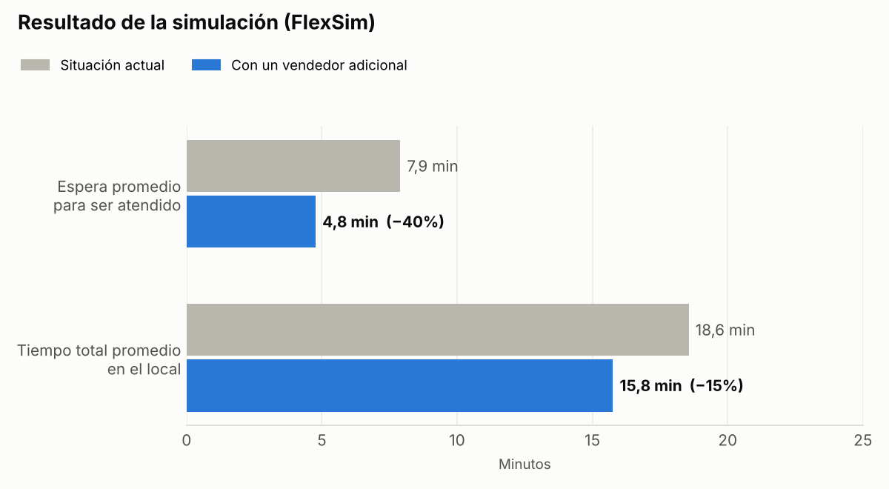
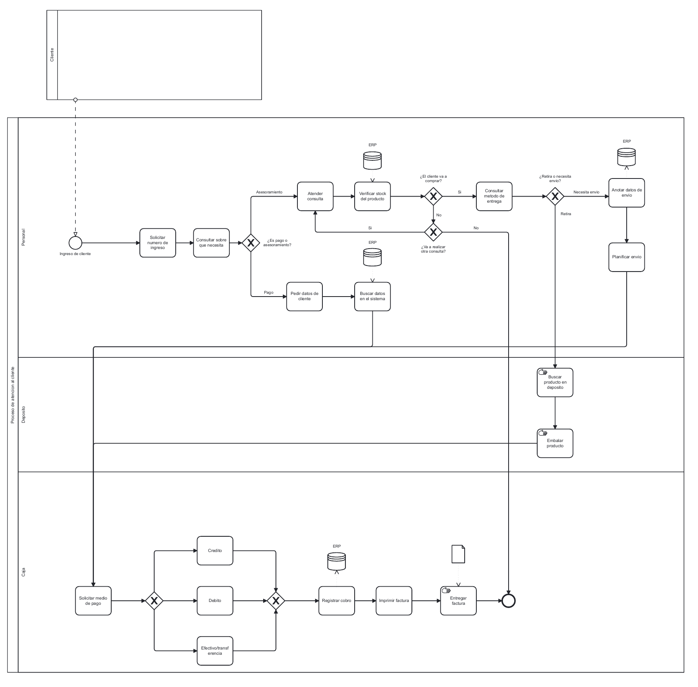
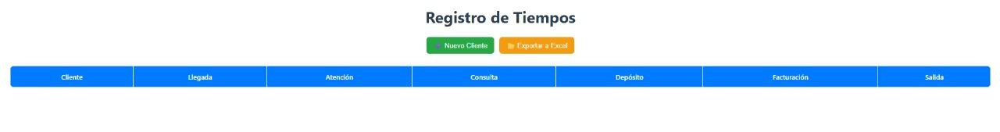
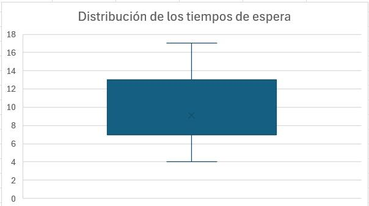
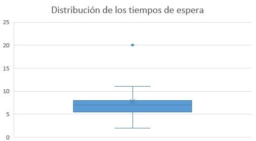
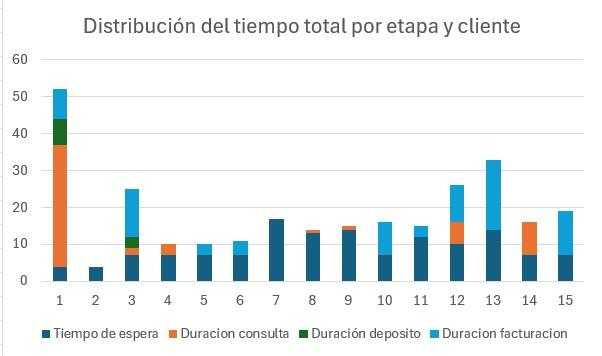
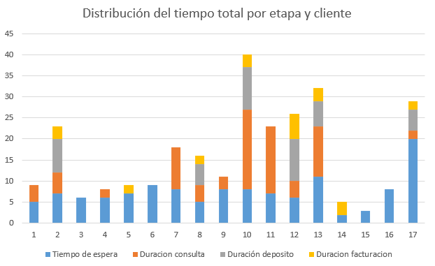
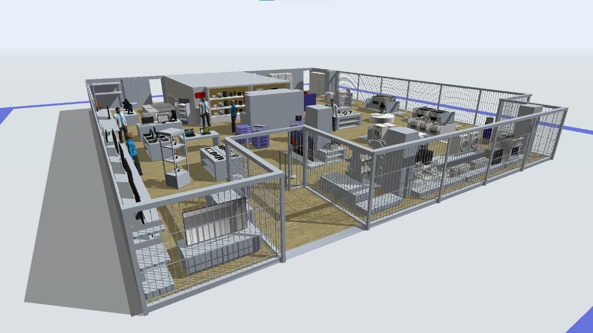

# Análisis y simulación del proceso de atención al cliente

Trabajo práctico integrador de la materia **Simulación** — Ingeniería en Sistemas de Información, UTN Facultad Regional San Francisco (2025).

Análisis de cómo se atiende a los clientes en la sucursal de una cadena de electrodomésticos y tecnología de San Francisco, Córdoba: medición de tiempos reales en el local, modelado del proceso y simulación para probar una mejora antes de aplicarla.



## Resumen

- **Problema:** los clientes esperaban mucho para ser atendidos, y muchas veces esperaban más tiempo del que duraba la atención.
- **Causa principal:** cada vendedor hace todo el proceso solo (asesora, va al depósito y factura). Mientras tanto, la fila no avanza.
- **Dato llamativo:** en el día de mucha demanda, **4 de 17 clientes se fueron sin ser atendidos**.
- **Resultado:** en la simulación, sumar un vendedor bajó la espera promedio de 7,9 a 4,8 minutos (**−40%**).

## Metodología

### 1. Relevamiento del proceso

A partir de una entrevista con el gerente, el proceso de atención se modeló en **BPMN** (Camunda). El diagrama muestra los tres sectores que intervienen: atención, depósito y caja.



### 2. Toma de datos con una app propia

Para medir los tiempos en el local se desarrolló una **app web en React**. Con un botón se agrega cada cliente que entra, y con otros se marca la hora de cada etapa: llegada, inicio de atención, consulta, depósito, facturación y salida. Al final se exporta todo a Excel (librerías XLSX y FileSaver.js).



Se midieron dos días con demanda distinta:

| Visita | Día | Clientes | Espera promedio (clientes atendidos) | Se fueron sin ser atendidos |
|---|---|---|---|---|
| Baja demanda | Jueves 11/09/2025, 17:55 a 18:50 | 15 | 9,5 min | 1 |
| Alta demanda | Sábado 11/10/2025, 10:46 a 11:44 (semana del Día de la Madre) | 17 | 7,7 min | 4 |

Los datos completos están en la carpeta [`datos/`](datos/).

### 3. Análisis de los datos

En Excel se calcularon promedio y desvío, con diagramas de caja para ver cómo se reparten las esperas y gráficos de barras para ver cuánto pesa cada etapa.

| Baja demanda | Alta demanda |
|---|---|
|  |  |
|  |  |

Hallazgos:

- **Aun con poca gente, la espera era alta.** El problema no es solo la cantidad de clientes, sino cómo se reparten las tareas.
- **En el día de mucha demanda las consultas y las visitas al depósito se alargan**, y mientras un vendedor está en el depósito no atiende a nadie.

### 4. Simulación

- Con los tiempos medidos se armaron tablas de probabilidad (**método de Monte Carlo**) para que la simulación genere tiempos parecidos a los reales.
- El plano del local se hizo en **SketchUp** y se importó en **FlexSim**, donde se configuró el recorrido de clientes y empleados.
- Se compararon dos escenarios: la situación actual y la misma situación con **un vendedor más**.



## Resultados

| Indicador (promedio) | Situación actual | Con un vendedor más | Cambio |
|---|---|---|---|
| Espera para ser atendido | 7,9 min | 4,8 min | −40% |
| Espera máxima | 15,0 min | 12,1 min | −19% |
| Tiempo total en el local | 18,6 min | 15,8 min | −15% |

Sumar un vendedor reduce mucho la espera, pero el tiempo total baja menos porque la atención en sí sigue siendo larga.

## Otras mejoras propuestas (sin simular)

- **Turnos diferenciados:** un número para pagos y consultas rápidas, y otro para compras y asesoramiento, así los trámites cortos no quedan atrás de los largos.
- **Reorganizar roles:** vendedores dedicados a atender, una persona fija en caja y otra en el depósito, en lugar de que cada vendedor haga todo.

## Limitaciones y posibles mejoras

- **Pocos datos:** se midieron dos días, una hora cada uno. Para conclusiones más firmes hacen falta más días y horarios.
- **Qué datos cargar en la simulación:** se usó la distribución de los tiempos de espera. Lo más correcto es cargar cada cuánto llegan los clientes y cuánto dura cada atención, y dejar que la espera salga como resultado de la simulación.
- **Una sola corrida por escenario:** lo ideal es correr cada escenario varias veces y comparar los promedios.
- **Abandono de clientes:** se observó pero no se modeló. Sería importante, porque cada cliente que se va es una venta perdida.
- **Costo:** no se comparó el costo de un sueldo más con el beneficio de atender más rápido.
- **Probar las otras propuestas:** simular los turnos diferenciados y la reorganización de roles, que no suman personal.

## Herramientas

React · JavaScript · CSS · XLSX + FileSaver.js · Excel · BPMN (Camunda) · SketchUp · FlexSim

## Contenido del repositorio

```
├── README.md
├── datos/
│   ├── visita1_baja_demanda.csv
│   └── visita2_alta_demanda.csv
└── imagenes/
```

Los CSV tienen una fila por cliente con la hora de cada etapa. Las celdas vacías son etapas que ese cliente no hizo (por ejemplo, no compró y no pasó por el depósito).
